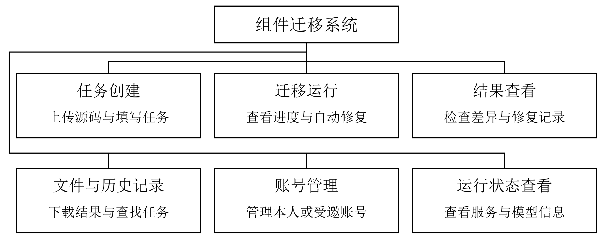

# 14. 功能设计

目前已将前述迁移流程整合到网页系统中，用户可以提交源码、查看进度、检查结果和下载文件。功能以一次迁移任务为主线，并补充历史记录、账号管理和运行状态查看，主要划分见图8，具体作用见表13。

图8  系统主要功能划分

表13  系统主要功能及作用

|功能模块|主要操作|作用|
|---|---|---|
|任务创建|上传或粘贴Vue源码，填写任务和检查配置。|统一提交一次迁移任务。|
|迁移运行|查看执行阶段、自动修复和停止原因。|了解任务进度及停止原因。|
|结果查看|比较两端界面，查看检查差异、代码和修复记录。|了解迁移效果及存在的问题。|
|文件与历史记录|下载代码与报告，查找并重新打开任务。|保存结果，便于后续查看。|
|账号管理|用户管理本人账号；管理员管理账号和使用额度。|分开管理不同用户的任务。|
|运行状态查看|查看后台连接、执行程序及模型信息。|发现服务未启动等运行问题。|

使用时，用户先上传Vue文件或粘贴源码，填写任务名称，并选择最多修复几轮，目前允许设置0—3轮。任务提交后，系统按前述流程处理，页面显示排队、执行中或已结束等状态；出现问题时给出原因，方便用户继续查看。

结果页面把检查结论、界面对比、San代码和修复记录放在一起。用户可以先看哪些检查通过、哪些没有通过，再查看具体差异或下载文件。没有配置交互检查时，系统显示“未测试”；已经生成代码和检查全部通过也分别记录，避免只看到文件就认为迁移成功。

多人使用时，普通用户只能查看和操作自己的任务，并可以修改密码、查看本人用量；管理员可以创建、启用或禁用账号，并设置使用额度。“设置与连接”页面主要用于查看服务状态，模型密钥和主要运行参数仍由后台配置。
