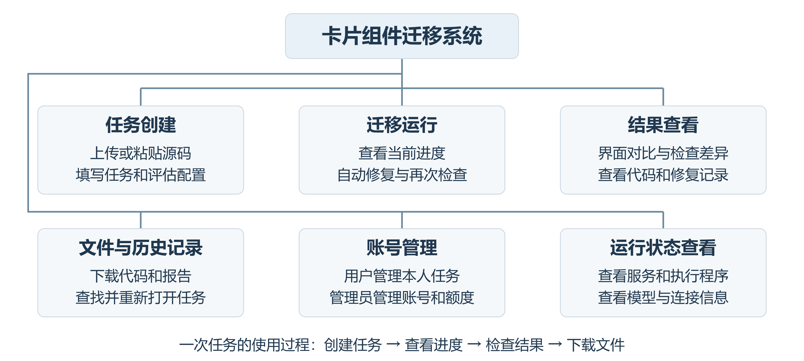

# 14 功能设计

前面介绍了从Vue源码到San代码的迁移过程。为了让这套流程真正方便使用，本研究进一步将这些步骤整合到一个网页系统中。用户可以在页面上提交源码、查看迁移进度、检查结果和下载文件，不需要为每一步分别执行命令。功能设计主要围绕一次迁移任务展开，同时提供历史记录、账号管理和运行状态查看等功能。

图 功能设计部分的系统功能划分示意图

系统主要包括以下六部分功能。

（1）任务创建。用户可以上传一个Vue文件，也可以直接粘贴源码，并为任务填写名称。提交前可以选择最多进行几轮修复，目前支持0至3轮。对于需要传入数据或检查交互的组件，还可以补充相应的评估配置。系统会检查文件格式、内容和大小，填写有问题时给出提示。

（2）迁移运行。任务提交后，系统依次进行源码检查、SSM提取、代码生成和质量检查。用户可以看到任务是在排队、执行中，还是已经结束。检查发现问题后，系统会在设置的轮数内尝试修复，并再次检查。任务停止时，页面会显示停止原因，方便用户区分正常结束和中途出错。

（3）结果查看。系统将检查结果集中展示，用户可以查看结构一致性、界面还原情况，以及源界面和迁移后界面的对比图。对于没有通过的检查，可以继续查看具体差异。用户还可以阅读当前保留的San代码和每轮修复记录，了解哪些修改被保留、哪些修改被放弃。没有配置交互检查时，页面会显示“未测试”，不会把这一项当作通过。

（4）文件与历史记录。用户可以下载已有的San代码、检查报告和相关文件，也可以在任务记录中按名称、文件名或状态查找之前的任务，重新打开报告。已经生成代码与检查全部通过分别显示，方便用户先查看有问题的结果，再决定如何处理。

（5）账号管理。多人使用时，普通用户登录后只能查看和操作自己的任务，并可以修改密码、查看本人用量。管理员负责创建账号、启用或禁用账号，以及设置任务和模型调用额度等。这样可以将不同用户的任务和使用记录分开管理，减少相互影响。

（6）运行状态查看。系统提供“设置与连接”页面，展示后台服务是否连接、迁移执行程序是否在线，以及当前使用的模型等信息。例如，任务一直处于排队状态时，用户可以先检查执行程序是否启动。模型密钥和主要运行参数仍由后台配置，页面主要用于查看状态。

这六部分功能共同组成了一次任务的使用过程：先创建任务，再查看进度和检查结果，最后下载需要的文件；历史记录用于后续查找和对比，账号管理和运行状态查看则为日常使用提供支持。

<!-- 待审说明：尚未获得包含第1至13节的最新版报告路径。本稿先供内容检查，未写入或覆盖原报告。图题编号、标题格式、字号及前后衔接须读取最新版后确定。功能根据当前前端和接口代码核对；当前不推进前端界面、后端技术栈或数据库设计的后续章节。 -->
